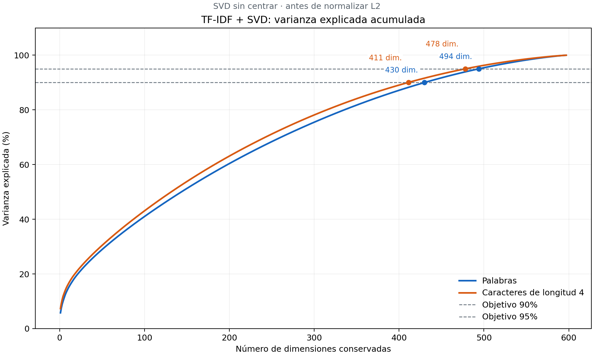

# Análisis de varianza de TF-IDF + SVD

SVD sin centrar, antes de normalizar L2. Los porcentajes describen varianza, no calidad del clustering.

| Representación | Objetivo | Dimensiones mínimas | Varianza alcanzada |
|---|---:|---:|---:|
| resultados_tfidf_completo | 90% | 430 | 90.0096% |
| resultados_tfidf_completo | 95% | 494 | 95.0254% |
| resultados_tfidf_caracteres4_completo | 90% | 411 | 90.0420% |
| resultados_tfidf_caracteres4_completo | 95% | 478 | 95.0173% |

## Comparación de dimensiones

| Representación | Dimensiones | Varianza acumulada |
|---|---:|---:|
| resultados_tfidf_completo | 50 | 28.93% |
| resultados_tfidf_completo | 100 | 41.00% |
| resultados_tfidf_completo | 200 | 60.37% |
| resultados_tfidf_completo | 300 | 75.49% |
| resultados_tfidf_completo | 400 | 87.17% |
| resultados_tfidf_completo | 430 | 90.01% |
| resultados_tfidf_completo | 494 | 95.03% |
| resultados_tfidf_completo | 500 | 95.42% |
| resultados_tfidf_completo | 597 | 99.99% |
| resultados_tfidf_caracteres4_completo | 50 | 30.44% |
| resultados_tfidf_caracteres4_completo | 100 | 43.08% |
| resultados_tfidf_caracteres4_completo | 200 | 63.11% |
| resultados_tfidf_caracteres4_completo | 300 | 78.15% |
| resultados_tfidf_caracteres4_completo | 400 | 89.07% |
| resultados_tfidf_caracteres4_completo | 411 | 90.04% |
| resultados_tfidf_caracteres4_completo | 478 | 95.02% |
| resultados_tfidf_caracteres4_completo | 500 | 96.30% |
| resultados_tfidf_caracteres4_completo | 597 | 99.99% |

El mínimo se busca en todas las dimensiones, no solo en las filas de esta tabla. `umbrales.csv` incluye la varianza de la dimensión anterior para comprobar el cruce.

Se diagonaliza la matriz entre usuarios X @ X.T sin centrarla. Las coordenadas SVD permiten calcular la varianza sin densificar todo TF-IDF. El coste de memoria crece con el cuadrado del número de usuarios.

Mínimos de la curva calculada. El modelo randomized guardado o un nuevo ajuste pueden diferir ligeramente; comprobar su resumen. No mide calidad del clustering.

Las matrices y los modelos existentes se conservan. Este análisis no genera nuevas representaciones para clustering.
