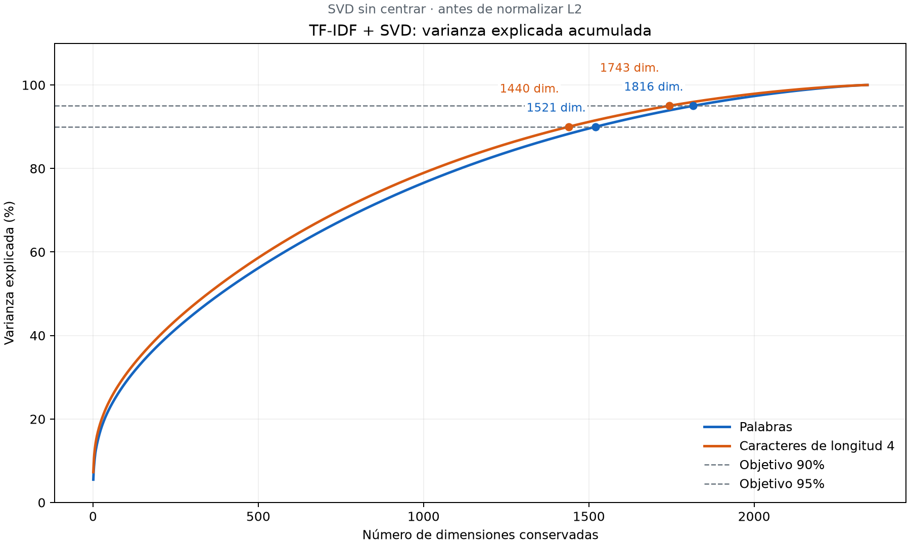

# Análisis de varianza de TF-IDF + SVD

SVD sin centrar, antes de normalizar L2. Los porcentajes describen varianza, no calidad del clustering.

| Representación | Objetivo | Dimensiones mínimas | Varianza alcanzada |
|---|---:|---:|---:|
| resultados_tfidf_completo | 90% | 1521 | 90.0010% |
| resultados_tfidf_completo | 95% | 1816 | 95.0130% |
| resultados_tfidf_caracteres4_completo | 90% | 1440 | 90.0182% |
| resultados_tfidf_caracteres4_completo | 95% | 1743 | 95.0119% |

## Comparación de dimensiones

| Representación | Dimensiones | Varianza acumulada |
|---|---:|---:|
| resultados_tfidf_completo | 50 | 22.54% |
| resultados_tfidf_completo | 100 | 28.89% |
| resultados_tfidf_completo | 200 | 37.86% |
| resultados_tfidf_completo | 300 | 44.84% |
| resultados_tfidf_completo | 400 | 50.82% |
| resultados_tfidf_completo | 500 | 56.14% |
| resultados_tfidf_completo | 750 | 67.47% |
| resultados_tfidf_completo | 1000 | 76.56% |
| resultados_tfidf_completo | 1500 | 89.58% |
| resultados_tfidf_completo | 1521 | 90.00% |
| resultados_tfidf_completo | 1816 | 95.01% |
| resultados_tfidf_completo | 2000 | 97.35% |
| resultados_tfidf_completo | 2343 | 100.00% |
| resultados_tfidf_caracteres4_completo | 50 | 24.36% |
| resultados_tfidf_caracteres4_completo | 100 | 30.73% |
| resultados_tfidf_caracteres4_completo | 200 | 39.85% |
| resultados_tfidf_caracteres4_completo | 300 | 47.01% |
| resultados_tfidf_caracteres4_completo | 400 | 53.15% |
| resultados_tfidf_caracteres4_completo | 500 | 58.62% |
| resultados_tfidf_caracteres4_completo | 750 | 70.04% |
| resultados_tfidf_caracteres4_completo | 1000 | 78.94% |
| resultados_tfidf_caracteres4_completo | 1440 | 90.02% |
| resultados_tfidf_caracteres4_completo | 1500 | 91.16% |
| resultados_tfidf_caracteres4_completo | 1743 | 95.01% |
| resultados_tfidf_caracteres4_completo | 2000 | 97.89% |
| resultados_tfidf_caracteres4_completo | 2343 | 100.00% |

El mínimo se busca en todas las dimensiones, no solo en las filas de esta tabla. `umbrales.csv` incluye la varianza de la dimensión anterior para comprobar el cruce.

Se diagonaliza la matriz entre usuarios X @ X.T sin centrarla. Las coordenadas SVD permiten calcular la varianza sin densificar todo TF-IDF. El coste de memoria crece con el cuadrado del número de usuarios.

Mínimos de la curva calculada. El modelo randomized guardado o un nuevo ajuste pueden diferir ligeramente; comprobar su resumen. No mide calidad del clustering.

Las matrices y los modelos existentes se conservan. Este análisis no genera nuevas representaciones para clustering.
